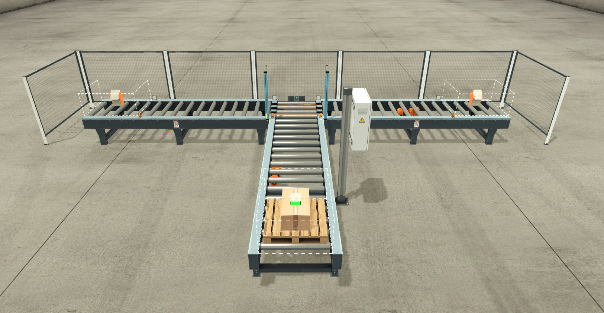
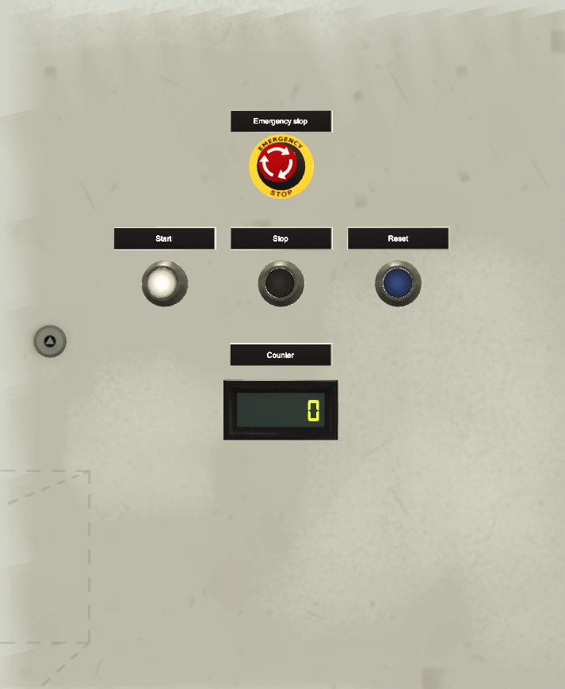

# Factory I/O Sorting by Height – PLC Ladder Logic (CODESYS)

Simulasi penyortir box berdasarkan tinggi di **Factory I/O** yang dikendalikan program **ladder logic CODESYS** (IEC 61131-3).

> **Objective:** Sort boxes by height onto two side conveyors (tall boxes to the left, short boxes to the right) and count the sorted boxes.

Sistem menerima box dari conveyor masuk, memuatnya ke posisi sensor tinggi, lalu mengklasifikasikannya sebagai box tinggi atau box pendek. Box tinggi dipindahkan ke conveyor kiri, box pendek ke conveyor kanan. Box yang keluar di ujung masing-masing conveyor dihitung, dan totalnya ditampilkan pada display.

## Demo

[TODO: Tonton video demo](link-video)

## Scene Factory I/O

*Tampilan depan scene: conveyor masuk, conveyor pemuat, dua transfer (kiri dan kanan), dua side conveyor, dan panel kontrol.*

### Panel Kontrol

*Panel operator: Emergency Stop, Start, Stop, Reset, dan display jumlah box tersortir.*

### Sensor dan Aktuator

| Sensor | Aktuator |
|---|---|
|  |  |
| Sensor conveyor: pallet sensor, loaded, at entry (kiri dan kanan), dan at exit (kiri dan kanan). | Aktuator conveyor: conveyor entry, load conveyor, conveyor kiri, dan conveyor kanan. |
|  |  |
| Sensor tinggi: high sensor (box tinggi) dan low sensor (box pendek). | Aktuator transfer: transfer left dan transfer right. |

## Tools

| Item | Keterangan |
|---|---|
| Simulasi | Factory I/O (scene Sorting by Height) |
| PLC / IDE | CODESYS (soft PLC) |
| Bahasa pemrograman | Ladder Diagram (LD) |
| Blok standar | CTU, ADD, TO_WORD, kontak edge (P/N) |

## Fungsi Push Button

| Tombol | Fungsi |
|---|---|
| **Start** | Menjalankan sistem. |
| **Stop** | Menghentikan sistem. |
| **E-Stop** | Menghentikan sistem secara paksa dan dikunci (latch). Sistem tidak dapat berjalan sampai latch dilepas dengan Reset. |
| **Reset** | Melepas latch E-Stop dan mereset counter. |

Ketentuan tombol Reset:
- Setelah E-Stop: tekan Reset sekali untuk melepas latch E-Stop. Counter tetap utuh. Lepas tombol, lalu tekan Reset sekali lagi jika ingin mengosongkan counter.
- Setelah Stop: saat sistem tidak berjalan, tekan Reset untuk mengosongkan counter.
- Counter tidak dapat direset saat sistem sedang berjalan.

## Alur Proses (Operasi Normal)

1. **Start**: Tombol `Start` mengaktifkan dan mengunci (latch) `System_Running`.
2. **Box masuk**: Conveyor masuk membawa box ke posisi pemuatan. Saat `Pallet_Sensor` mendeteksi box, conveyor masuk berhenti dan conveyor pemuat memuat box.
3. **Klasifikasi tinggi**: `High_Sensor` dan `Low_Sensor` terpasang pada dua ketinggian berbeda. Box tinggi terdeteksi oleh `High_Sensor`, sehingga dikunci pada latch `High_Item`. Box pendek tidak mengaktifkan `High_Sensor`, sehingga `High_Item` tetap tidak aktif dan box ditangani oleh jalur box pendek.
4. **Transfer**: Instance `Height_Sorter` untuk box tinggi memindahkan box ke kiri. Instance untuk box pendek (hanya aktif saat `High_Item` tidak aktif) memindahkan box ke kanan.
5. **Side conveyor**: Setelah box sampai di pintu masuk side conveyor (`At_Entry_Left` atau `At_Entry_Right`), transfer berhenti dan side conveyor membawa box ke ujung conveyor.
6. **Menghitung box**: Saat box melewati sensor di ujung conveyor (`At_left_Exit` atau `At_right_Exit`), rising edge menaikkan counter masing-masing sisi. Kedua counter dijumlahkan, dikonversi ke WORD, lalu dikirim ke display.

## Struktur Program

Program terdiri dari satu program utama (`PLC_PRG`) dan tiga function block yang dipakai ulang.

### PLC_PRG

| Rung | Fungsi |
|---|---|
| 1–3 | E-Stop: konfirmasi sinyal dan latch |
| 4 | Reset melepas latch E-Stop |
| 5 | Start / Stop sistem (`System_Running`) |
| 6 | Izin conveyor masuk |
| 7 | Output conveyor masuk |
| 8 | Box terdeteksi: stop conveyor masuk |
| 9 | Latch proses pemuatan |
| 10 | Output conveyor pemuat |
| 11 | Latch box tinggi (`High_Item`) |
| 12 | `Height_Sorter` HIGH: transfer kiri |
| 13 | Side conveyor kiri |
| 14 | `Height_Sorter` LOW: transfer kanan |
| 15 | Side conveyor kanan |
| 16 | Counter dan display |

### Function Block

| FB | Fungsi | Dipakai |
|---|---|---|
| `Height_Sorter` | Mendeteksi box, meminta transfer, dan menghentikan transfer | 2x (HIGH dan LOW) |
| `Side_Conveyor` | Menjalankan side conveyor dari pintu masuk sampai ujung | 2x (kiri dan kanan) |
| `Sorting_Counter` | Menghitung box kiri dan kanan, menjumlahkan, dan konversi ke display | 1x |

## Teknik yang Dipakai

- **E-Stop latch**: sinyal E-Stop dikonfirmasi lalu dikunci menjadi satu sinyal `E_StopLatched` yang dipakai semua blok. Latch hanya dilepas oleh Reset saat tombol E-Stop sudah dilepas.
- **Desain modular**: tiap fungsi dibuat sebagai function block dan dipakai ulang (`Height_Sorter` dan `Side_Conveyor` masing-masing dua instance), sehingga sisi kiri dan kanan memakai logika yang sama.
- **Reset counter dua tahap**: tekanan Reset yang melepas latch E-Stop ditangkap dan diabaikan oleh counter, sehingga jumlah box tidak hilang tanpa disengaja.
- **Penghitungan berbasis edge**: counter dinaikkan oleh rising edge sensor ujung conveyor, sehingga satu box dihitung satu kali.
- **Latching bertahap**: kondisi seperti box terdeteksi dan izin transfer disimpan pada latch, lalu dilepas oleh event berikutnya (misalnya box sampai di pintu masuk side conveyor).

## Komunikasi

Program CODESYS terhubung ke Factory I/O melalui **Modbus TCP**. CODESYS berperan sebagai slave (Slave ID 1) dan Factory I/O sebagai client yang terhubung ke `127.0.0.1:502`.

Arah data dilihat dari sisi PLC:
- **Coil** (Factory I/O ke PLC): sensor dan tombol, terbaca di CODESYS sebagai input (`%IX4.x`, `%IX5.x`).
- **Discrete Input dan Input Register** (PLC ke Factory I/O): aktuator dan counter, ditulis dari output CODESYS (`%QX4.x`, `%QW0`).

### Input PLC (Coil)

| Coil | Label di Factory I/O | Variabel |
|---|---|---|
| 0 | High sensor | `High_Sensor` |
| 1 | Low sensor | `Low_Sensor` |
| 2 | Pallet sensor | `Pallet_Sensor` |
| 3 | Loaded | `Loaded` |
| 4 | At left entry | `At_Entry_Left` |
| 5 | At left exit | `At_left_Exit` |
| 6 | At right entry | `At_Entry_Right` |
| 7 | At right exit | `At_right_Exit` |
| 8 | Start | `Start` |
| 9 | Reset | `Reset` |
| 10 | Stop | `Stop` (NC) |
| 11 | Emergency stop | `E_Stop` (NC) |

### Output PLC (Discrete Input dan Input Register)

| Alamat | Label di Factory I/O | Variabel |
|---|---|---|
| Input 0 | Conveyor entry | `Conveyor_Entry` |
| Input 1 | Load | `Load_Conveyor` |
| Input 3 | Transf. left | `Transfer_Left` |
| Input 4 | Transf. right | `Transfer_Right` |
| Input 5 | Conveyor left | `Conveyor_Left` |
| Input 6 | Conveyor right | `Conveyor_Right` |
| Input Reg 0 | Counter | `Display_Dig` |

## Penulis

**Izzuddin Alqassam**, Teknik Elektro, Universitas Hasanuddin
Fokus: sistem kontrol, PLC, otomasi industri